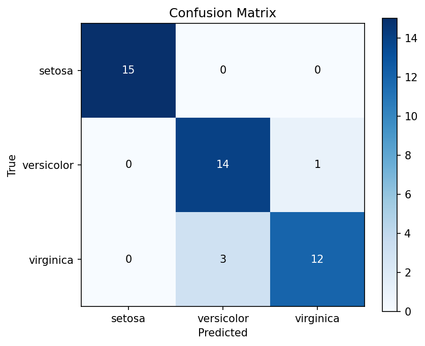

# Iris Classification
- Predict species from 4 measurements
- 150 samples, 3 balanced classes
# Results
| Metric | Value |
|--------|-------|
| Test accuracy | 0.911 |
| 5-fold CV | 0.960 (+/- 0.039) |
| Baseline | 0.333 |

# Conclusion
- Simple validated model separates species reliably
